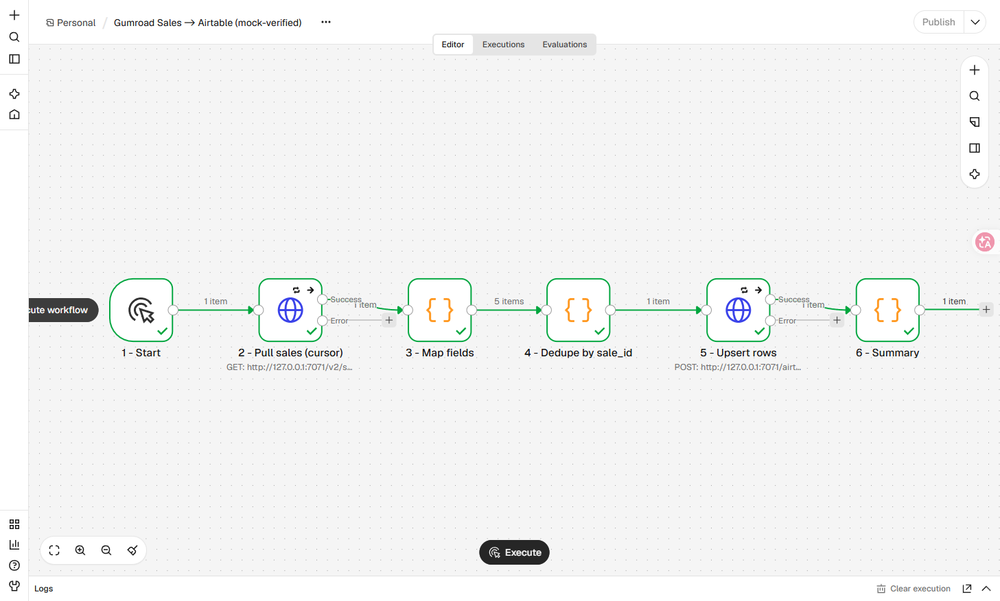

# Gumroad sales -> Airtable (mock-verified)

Built for exactly the failure the client described: an automation that *looks* like it runs.
I did not have a Gumroad token, so I built a local mock that reproduces the parts that actually break it:
cursor pagination, a 429 on the first call, and a duplicate row delivered by the cursor.

## The pipeline

1. **Start** (manual trigger)
2. **Pull sales** - GET /v2/sales with `page_key` cursor. `retryOnFail: 3`, `waitBetweenTriesMs: 2000`, error output wired.
3. **Map fields** - sale_id, email, product_id, amount (cents -> decimal), currency, transaction_date.
4. **Dedupe by sale_id** - in-batch dedupe before any write.
5. **Upsert rows** - POST to the table with the same retry settings.
6. **Summary** - what went in, what the write returned.



## The two runs that matter

Run 1, from the mock log:

```
GET /v2/sales call=1  -> 429 rate limited
GET /v2/sales call=2  -> 200           (retry fired, no data lost)
POST /airtable/upsert in=5 inserted=5 updated=0 total=5
```

Run 2, same input, no changes:

```
POST /airtable/upsert in=5 inserted=0 updated=5 total=5
```

That second line is the whole point: a re-run or a duplicate poll cannot create a second row.
Full log: `gumroad-run-log.txt`

## What is real and what is not

- Real: the workflow, the nodes, the retry behaviour, the dedupe, the failure routing. All executed, screenshots are from those runs.
- Not real: the API. `gumroad-mock.cjs` stands in for Gumroad and Airtable. With a read-only Gumroad token and a base id, node 2 and node 5 point at the real endpoints and nothing else changes.
- No client data anywhere. Every sale in the mock is invented.

## Files

- `gumroad-airtable-workflow.json` - imports into n8n as-is
- `gumroad-mock.cjs` - `node gumroad-mock.cjs`, listens on 127.0.0.1:7071
- `gumroad-run.png`, `gumroad-run-log.txt`